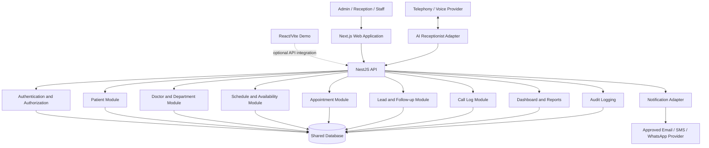

# Product Requirements Document (PRD)
## Hospital Management System — Unified Module Integration

**Version:** 1.0  
**Date:** 27 October 2026  
**Status:** Draft for technical review and implementation  
**Product:** Hospital Management System (HMS)  
**Primary objective:** Integrate the existing software modules into one cohesive, functional, testable application.

---

## 1. Executive Summary

The Hospital Management System (HMS) currently consists of multiple independently developed software modules, including authentication and audit logging, appointments, doctor scheduling, patient and call management, departments and services, dashboard reports, leads and follow-up tasks, and an AI voice receptionist/notification feature.

The objective of this project is to integrate these modules into the existing HMS architecture so that they share consistent data, authentication, business rules, APIs, and user workflows.

The integration must preserve existing functionality, eliminate duplicated business logic, establish reliable communication between modules, and provide a unified user experience.

The integrated system must support routine hospital administration workflows, from patient registration and appointment scheduling to enquiry management, receptionist call handling, reporting, and auditing.

The first deliverable is a functional demonstration using fictional records. Real telephony, external notification services, and production deployment are conditional on approved credentials, implementation readiness, and security review.

### 1.1 Product objectives

1. Integrate the existing branches without unnecessarily rewriting working modules.
2. Establish a shared backend and consistent data ownership.
3. Provide secure authentication and role-based authorization.
4. Implement end-to-end workflows across patients, doctors, appointments, enquiries, and call logs.
5. Connect dashboard reports and audit logs to actual system operations.
6. Integrate the AI receptionist through a provider-neutral adapter and authoritative HMS APIs.
7. Provide automated tests and a reproducible demonstration environment.

### 1.2 Success definition

The integration is successful when a user can execute the core administrative workflows through the unified application, the resulting changes are reflected consistently across relevant modules, protected operations enforce permissions, and automated integration tests pass.

A successful Git merge alone does not satisfy these criteria.

---

## 2. Product Scope and Boundaries

### 2.1 In scope

- Authentication, session management, roles, and permissions.
- Admin dashboard and operational reports.
- Doctor, department, service, and schedule management.
- Patient registration, search, and directory management.
- Appointment creation, rescheduling, cancellation, and status tracking.
- Enquiry and lead capture with follow-up tasks.
- Reception call logs and AI call outcomes.
- AI receptionist workflows for approved FAQs and appointment requests.
- Demo notifications through a mock provider or approved test credentials.
- Audit logs for security-relevant and business-critical operations.
- Seed data, automated tests, and a scripted demonstration.

### 2.2 Out of scope for the first demo

- Electronic medical records, diagnosis, prescriptions, and clinical decision support.
- AI-generated medical advice or autonomous emergency triage.
- Insurance claims and billing integrations.
- Pharmacy, laboratory, radiology, inpatient, and bed-management modules unless separately approved.
- Live hospital deployment using real patient data without formal approval.
- Unapproved external integrations or real telephony charges.

### 2.3 Scope classification

| Capability | First-demo expectation |
|---|---|
| Core administration | Functional end-to-end |
| Appointment management | Functional with validated scheduling |
| Leads and follow-ups | Functional end-to-end |
| Authentication and permissions | Enforced by the backend |
| Dashboard and reports | Based on persisted application records |
| Audit logging | Records relevant operations |
| Notifications | Mock delivery or approved test integration |
| AI receptionist | Functional when voice infrastructure is configured; otherwise a clearly labelled simulation |
| Live telephony | Conditional on provider selection and configuration |

---

## 3. Existing Architecture and Integration Strategy

### 3.1 Known repository structure

The existing repository uses an npm workspace configuration and Turborepo.

| Component | Current documented role | Integration responsibility |
|---|---|---|
| `apps/api` | NestJS backend with Prisma | Authoritative business logic, APIs, validation, persistence, authorization |
| `apps/web` | Next.js frontend | Unified administrative and reception interface |
| `apps/demo` | React/Vite demo with browser-local fictional data | Presentation and demonstration environment |
| `packages/*` | Shared packages | Reusable types, schemas, configuration, or utilities where appropriate |

The actual capabilities and dependencies of each merged branch must be verified before implementation.

### 3.2 Branches to review

The following branches were identified in the repository:

- `auth-and-audit-logs`
- `feature/ai-voice-receptionist-notifications`
- `feature/appointemnts-module`
- `feature/dashboard-reports`
- `feature/doctor-schedule-availability-api`
- `feature/patient-&-call-overview-module`
- `module-3/departments-services+settings`
- `module5/leads-enquiries+follow-uptasks`
- `module7/standalone-module`
- `integration/full-software-modules-2026-10-27`

Branch names indicate intended responsibilities, not proof that every feature is implemented or working.

### 3.3 Target architecture

The recommended initial architecture is a modular monolith: one authoritative backend application divided into clear business modules, supported by a shared database and a unified frontend. Separate services should be introduced only when justified by operational or scaling requirements.

The target structure is:

- **Frontend:** Next.js application in `apps/web`.
- **Backend:** NestJS modules in `apps/api`.
- **Persistence:** Prisma-managed database.
- **Shared contracts:** Reusable request/response schemas and types where appropriate.
- **External integrations:** Provider adapters for AI, telephony, and notifications.
- **Demo environment:** `apps/demo`, clearly separated from the authoritative application backend.

The demo may remain independently runnable, but its data and capabilities must not be represented as production-integrated unless it actually calls the shared backend.

### 3.4 Logical architecture



---

## 4. Users and Roles

The system shall support role-based access. The final permission matrix must be confirmed against existing authentication code and operational requirements.

| Role | Intended responsibilities |
|---|---|
| Administrator | Manage users, roles, departments, services, configuration, and authorized reports |
| Receptionist | Register patients, manage appointments, process enquiries, and review calls |
| Doctor | View permitted schedule and appointment information |
| Department manager | Manage authorized department resources and schedules |
| Reporting/audit user | Access permitted reports and audit records |
| AI receptionist service identity | Perform explicitly authorized operations through scoped API permissions |

Role assignment must not be implemented as a trusted frontend-only selection. All protected operations must be authorized by the backend.

The AI receptionist must not inherit unrestricted administrator privileges.

---

## 5. Functional Requirements

Each requirement has a unique identifier for implementation and testing. Priority levels are **P0** (required for the core integrated demo), **P1** (required for the complete scoped demo), and **P2** (enhancement or conditional capability).

### 5.1 Authentication and audit logging

| ID | Requirement | Priority |
|---|---|---|
| FR-AUTH-01 | The system shall authenticate users through the approved authentication mechanism. | P0 |
| FR-AUTH-02 | The backend shall enforce role-based permissions for protected endpoints. | P0 |
| FR-AUTH-03 | Unauthorized requests shall return appropriate authentication or authorization errors. | P0 |
| FR-AUTH-04 | User sessions or tokens shall be validated and expire according to configured policy. | P0 |
| FR-AUTH-05 | Security-relevant and business-critical operations shall generate audit events. | P0 |
| FR-AUTH-06 | Audit records shall capture actor, action, resource, timestamp, and outcome where applicable. | P0 |
| FR-AUTH-07 | Users shall only access audit records permitted by their role. | P0 |

### 5.2 Dashboard and reports

| ID | Requirement | Priority |
|---|---|---|
| FR-DASH-01 | The dashboard shall display relevant operational metrics from persisted records. | P0 |
| FR-DASH-02 | Appointment metrics shall reflect the actual status and date of appointments. | P0 |
| FR-DASH-03 | Lead, callback, and call-outcome metrics shall reflect the corresponding modules. | P1 |
| FR-DASH-04 | Reports shall support appropriate date-range and status filters. | P1 |
| FR-DASH-05 | Dashboard counts shall respect authorization and defined reporting rules. | P0 |
| FR-DASH-06 | The interface shall provide loading, empty, and error states for unavailable report data. | P1 |

### 5.3 Departments, services, doctors, and schedules

| ID | Requirement | Priority |
|---|---|---|
| FR-ORG-01 | Authorized users shall create, view, update, and deactivate departments and services. | P0 |
| FR-ORG-02 | Authorized users shall manage doctor profiles and department associations. | P0 |
| FR-ORG-03 | Authorized users shall configure doctor availability, working hours, and applicable scheduling rules. | P0 |
| FR-ORG-04 | The availability API shall return slots derived from persisted schedules and existing appointments. | P0 |
| FR-ORG-05 | The system shall reject invalid slots and prevent overlapping bookings where prohibited. | P0 |
| FR-ORG-06 | Inactive doctors, departments, and services shall not be offered for new appointments. | P0 |
| FR-ORG-07 | Scheduling shall use a defined hospital timezone and consistent timestamp conventions. | P0 |

### 5.4 Patient management

| ID | Requirement | Priority |
|---|---|---|
| FR-PAT-01 | Authorized staff shall register a patient using the required minimum fields. | P0 |
| FR-PAT-02 | Staff shall search and filter the patient directory using permitted fields. | P0 |
| FR-PAT-03 | Patient records shall have stable identifiers independent of names or phone numbers. | P0 |
| FR-PAT-04 | The system shall detect likely duplicate registrations and provide a review path. | P1 |
| FR-PAT-05 | Patient information shall only be returned to authorized users and services. | P0 |
| FR-PAT-06 | Uncertain identity matches shall require staff review instead of exposing an existing record. | P0 |

### 5.5 Appointment management

| ID | Requirement | Priority |
|---|---|---|
| FR-APT-01 | Authorized users shall create appointments linked to valid patient and doctor records. | P0 |
| FR-APT-02 | The system shall validate doctor, department, schedule, and slot availability before booking. | P0 |
| FR-APT-03 | Authorized users shall reschedule appointments to valid available slots. | P0 |
| FR-APT-04 | Authorized users shall cancel appointments with an appropriate status and audit event. | P0 |
| FR-APT-05 | The appointment list shall support relevant date, doctor, department, patient, and status filters. | P0 |
| FR-APT-06 | The system shall distinguish confirmed bookings from pending requests. | P0 |
| FR-APT-07 | Concurrent booking attempts shall not create conflicting appointments. | P0 |
| FR-APT-08 | Relevant appointment changes shall be reflected in the dashboard and permitted views. | P0 |
| FR-APT-09 | Appointment status transitions shall follow an explicitly defined state model. | P1 |

### 5.6 Enquiries, leads, and follow-up tasks

| ID | Requirement | Priority |
|---|---|---|
| FR-LEAD-01 | Staff shall create leads from enquiries and other approved sources. | P0 |
| FR-LEAD-02 | Each lead shall support an appropriate status, source, owner, and contact details. | P0 |
| FR-LEAD-03 | Staff shall create callback or follow-up tasks linked to a lead where applicable. | P0 |
| FR-LEAD-04 | Tasks shall support due dates, assignment, completion, and overdue identification. | P1 |
| FR-LEAD-05 | Staff shall update lead status to contacted, converted, or closed according to configured workflow. | P0 |
| FR-LEAD-06 | A converted lead may be linked to a patient or appointment without creating duplicate records unnecessarily. | P1 |
| FR-LEAD-07 | The system shall record relevant lead and task changes in the audit trail. | P1 |

### 5.7 Reception call logs and outcomes

| ID | Requirement | Priority |
|---|---|---|
| FR-CALL-01 | The system shall record a call identifier, timestamp, outcome, and available routing metadata. | P0 |
| FR-CALL-02 | Call logs shall distinguish completed, failed, escalated, and abandoned calls where supported. | P0 |
| FR-CALL-03 | Staff shall search and filter call logs by permitted attributes. | P1 |
| FR-CALL-04 | Calls may be linked to a patient, lead, appointment, or callback task when the relationship is established reliably. | P0 |
| FR-CALL-05 | Staff shall be able to review a structured call summary and follow-up outcome. | P1 |
| FR-CALL-06 | Sensitive call content shall not be collected or retained unnecessarily. | P0 |

### 5.8 AI voice receptionist

| ID | Requirement | Priority |
|---|---|---|
| FR-AI-01 | The receptionist shall identify itself as a virtual AI receptionist at the beginning of the call. | P0 |
| FR-AI-02 | It shall support configured languages and communicate when a language is unsupported. | P1 |
| FR-AI-03 | It shall identify approved intents, including appointment requests, doctor availability, opening hours, location, FAQs, and human assistance. | P0 |
| FR-AI-04 | It shall collect only necessary appointment-request details. | P0 |
| FR-AI-05 | It shall retrieve availability from the authoritative HMS API rather than generating slots. | P0 |
| FR-AI-06 | It shall repeat key appointment details and obtain explicit caller confirmation before submitting a booking request. | P0 |
| FR-AI-07 | It shall report the actual API outcome and distinguish a pending request from a confirmed appointment. | P0 |
| FR-AI-08 | It shall create a call log with a structured outcome and summary. | P0 |
| FR-AI-09 | It shall support human escalation or a staff callback when requested or when processing fails. | P0 |
| FR-AI-10 | It shall provide approved fallback behavior for silence, noisy calls, unsupported languages, and API outages. | P1 |
| FR-AI-11 | It shall not diagnose, prescribe, interpret medical results, or provide autonomous emergency triage. | P0 |
| FR-AI-12 | Potential emergencies shall trigger immediate instructions to contact local emergency services or the hospital's designated emergency line. | P0 |
| FR-AI-13 | Recording and consent behavior shall comply with applicable requirements and configured policy. | P0 |
| FR-AI-14 | The AI integration shall use a replaceable provider adapter rather than hard-coding one voice vendor into core HMS logic. | P1 |

If the voice provider has not been selected or configured, the demo shall use a clearly labelled simulation. A simulated interaction must not be presented as a live telephone call.

### 5.9 Notifications

| ID | Requirement | Priority |
|---|---|---|
| FR-NOT-01 | The system shall define notification events for successful appointment operations and approved follow-up workflows. | P0 |
| FR-NOT-02 | A notification shall not claim that an appointment is confirmed unless the backend confirms it. | P0 |
| FR-NOT-03 | Demo notifications shall use a mock provider or an explicitly approved test integration. | P0 |
| FR-NOT-04 | Provider acceptance, delivery status where available, and failures shall be represented accurately. | P1 |
| FR-NOT-05 | Notification requests shall use approved templates and appropriate destination validation. | P1 |
| FR-NOT-06 | Retries shall not result in duplicate notifications when the provider supports idempotency or equivalent deduplication. | P1 |
| FR-NOT-07 | Provider credentials shall be stored outside source control. | P0 |

### 5.10 Shared data and cross-module workflows

| ID | Requirement | Priority |
|---|---|---|
| FR-INT-01 | All integrated modules shall use consistent identifiers and shared data ownership rules. | P0 |
| FR-INT-02 | A successful appointment booking shall be visible in the appointment list and applicable dashboard metrics. | P0 |
| FR-INT-03 | A caller enquiry may create a lead and a callback task when permission and workflow rules allow. | P0 |
| FR-INT-04 | AI-created requests shall appear in the reception interface with their actual status. | P0 |
| FR-INT-05 | Appointment and lead operations shall not create duplicate records because of retries. | P0 |
| FR-INT-06 | The system shall handle unavailable downstream modules or providers without reporting false success. | P0 |
| FR-INT-07 | The application shall provide a consistent error format and validation behavior across APIs. | P0 |

---

## 6. Core End-to-End User Journeys

### Journey A: Reception books an appointment

1. The receptionist authenticates.
2. The receptionist searches for a patient or registers a fictional patient.
3. The receptionist selects a department, doctor, date, and available slot.
4. The backend validates the slot and commits the appointment.
5. The appointment list and dashboard reflect the result.
6. A demo notification is generated or an approved provider is invoked.
7. An audit event records the relevant operation.

**Acceptance condition:** The appointment is persisted, visible in permitted views, and not duplicated or in conflict with another booking.

### Journey B: AI requests or books an appointment

1. A caller reaches the configured receptionist or simulation.
2. The AI identifies itself and determines the caller's intent.
3. It collects minimum necessary information and confirms the requested details.
4. It retrieves current availability from the HMS API.
5. It offers only returned slots.
6. After explicit caller confirmation, it submits the request.
7. The AI reports the actual backend outcome.
8. The call log and reception dashboard reflect the outcome.
9. A notification is sent only under the applicable success and consent rules.

**Acceptance condition:** No invented availability, false booking confirmation, or unauthorized disclosure of patient data.

### Journey C: Enquiry and follow-up

1. A caller enquires about a hospital service.
2. Staff or the AI captures the approved minimum information.
3. Where appropriate, permission is obtained to arrange a callback.
4. The backend creates a lead and follow-up task.
5. The receptionist dashboard displays the assigned task and due date.
6. Staff updates the lead status and records the outcome.

**Acceptance condition:** The enquiry, task, and subsequent status changes remain linked and auditable.

### Journey D: Doctor unavailable

1. A caller requests an unavailable slot.
2. The backend returns the actual availability result.
3. The AI offers available alternatives, if any.
4. If no suitable slot exists, the AI offers a staff callback or request workflow.
5. The system records the outcome and any follow-up task.

**Acceptance condition:** No unavailable slot is promised or booked.

---

## 7. Shared Data Model and Ownership

The integration must establish a canonical data model before connecting modules.

| Entity | Purpose and relationships |
|---|---|
| User | Authentication identity, role assignments, and account status |
| Role / Permission | Authorization rules |
| Department | Organizational unit containing services and doctor associations |
| Service | Approved hospital service offered by a department |
| Doctor | Doctor profile and department associations |
| DoctorSchedule | Working periods, availability rules, and relevant exceptions |
| Patient | Stable patient identity and minimum required registration details |
| Appointment | Patient, doctor, service/department, scheduled time, status, and source |
| Lead | Enquiry, contact details, source, status, and owner |
| FollowUpTask | Lead or operational follow-up, assignee, due date, and status |
| CallLog | Call metadata, outcome, summary, and relevant links |
| Notification | Notification type, destination reference, provider status, and retry metadata |
| AuditLog | Actor, action, target, timestamp, outcome, and permitted context |

### 7.1 Data integrity rules

- Use stable primary keys; do not use names as record identifiers.
- Define foreign keys and appropriate database constraints.
- Use database transactions for multi-step operations that must succeed or fail together.
- Enforce booking conflict prevention in the backend and database strategy, not only in the UI.
- Use explicit appointment, lead, task, call, and notification status values.
- Preserve historical records when deactivating doctors, services, or users.
- Avoid storing payment credentials, passwords, OTPs, or unnecessary sensitive call content.
- Use synthetic seed data for the first demo.

The existing Prisma schema must be reviewed before adding or changing models. The team should extend existing entities when possible rather than creating duplicate patient or appointment tables.

---

## 8. API Integration Requirements

The following routes are proposed logical contracts, not a claim that these endpoints already exist. They must be reconciled with the current NestJS controllers and naming conventions.

| Method | Proposed endpoint | Purpose |
|---|---|---|
| GET | `/api/departments` | List permitted departments |
| GET | `/api/services` | List permitted services |
| GET | `/api/doctors` | Search and list doctors |
| GET | `/api/doctors/:id/availability` | Retrieve actual available slots |
| POST | `/api/patients` | Register a patient |
| GET | `/api/patients` | Search the permitted patient directory |
| GET | `/api/appointments` | List appointments with filters |
| POST | `/api/appointments` | Create a validated appointment |
| PATCH | `/api/appointments/:id` | Update permitted appointment fields |
| POST | `/api/appointments/:id/cancel` | Cancel an appointment |
| POST | `/api/leads` | Create an enquiry lead |
| POST | `/api/follow-up-tasks` | Create a callback/follow-up task |
| GET | `/api/call-logs` | Search authorized call logs |
| POST | `/api/call-logs` | Record a call outcome |
| GET | `/api/reports/summary` | Retrieve operational metrics |
| GET | `/api/audit-logs` | Retrieve authorized audit records |
| POST | `/api/notifications` | Submit an authorized notification request |

The exact update and cancellation semantics must follow the existing API conventions. Public access to sensitive internal endpoints must not be assumed.

### 8.1 API contract standards

Every integrated endpoint shall define:

- Request schema and field validation.
- Authentication and authorization requirements.
- Success response and status codes.
- Validation, conflict, and server-error responses.
- Pagination and filtering conventions where applicable.
- Timestamp and timezone conventions.
- Idempotency behavior for retryable write operations where appropriate.
- Logging and correlation identifiers for troubleshooting.

Example availability response:

```json
{
  "doctorId": "doctor_demo_01",
  "date": "2026-11-02",
  "timezone": "Asia/Kolkata",
  "slots": [
    {
      "start": "2026-11-02T09:00:00+05:30",
      "end": "2026-11-02T09:30:00+05:30"
    }
  ]
}
```

This is illustrative contract data, not an actual available slot. The backend must generate real response values from its schedule and booking data.

---

## 9. Non-Functional Requirements

The following targets are proposed initial acceptance thresholds. They must be validated against the actual hosting environment and refined during technical kickoff.

### 9.1 Performance

| ID | Requirement | Proposed target |
|---|---|---|
| NFR-PERF-01 | Standard read API latency | p95 ≤ 500 ms under the agreed test load |
| NFR-PERF-02 | Standard write API latency | p95 ≤ 800 ms, excluding external provider delays |
| NFR-PERF-03 | Dashboard initial data retrieval | ≤ 2 seconds under the agreed test load |
| NFR-PERF-04 | Patient search | ≤ 1 second for the agreed seed dataset |
| NFR-PERF-05 | Report generation | ≤ 3 seconds for agreed demo-sized datasets |
| NFR-PERF-06 | Concurrent appointment booking | No conflicting successful bookings for the same exclusive slot |

All latency measurements should specify the test environment, dataset size, concurrency, and percentile methodology. External voice and notification latency must be measured separately.

### 9.2 Security and privacy

| ID | Requirement |
|---|---|
| NFR-SEC-01 | Enforce authentication and authorization on the server for all protected operations. |
| NFR-SEC-02 | Validate and sanitize incoming data and use parameterized database access through approved ORM practices. |
| NFR-SEC-03 | Store secrets in environment configuration or an approved secret-management system; never commit credentials. |
| NFR-SEC-04 | Use HTTPS in deployed environments and protect session/token handling. |
| NFR-SEC-05 | Restrict patient data and call-log access by role and business purpose. |
| NFR-SEC-06 | Prevent sensitive data, credentials, tokens, and unnecessary patient information from entering application logs. |
| NFR-SEC-07 | Record security-relevant actions in a protected audit trail. |
| NFR-SEC-08 | Apply rate limiting and abuse protection to exposed authentication and integration endpoints. |
| NFR-SEC-09 | Verify webhook authenticity and protect against replay where the provider supports the required mechanisms. |
| NFR-SEC-10 | Use least-privilege service credentials for AI, telephony, and notification adapters. |

The demo must use fictional records. Any production use involving personal or health information requires appropriate legal, privacy, security, and operational approval.

### 9.3 Reliability and resilience

| ID | Requirement |
|---|---|
| NFR-REL-01 | A failure in one external integration must not falsely report success for the overall operation. |
| NFR-REL-02 | Appointment creation and rescheduling shall preserve data consistency under failure and concurrency. |
| NFR-REL-03 | External provider calls shall use bounded timeouts and controlled retry policies. |
| NFR-REL-04 | Retryable operations shall use idempotency or deduplication where applicable. |
| NFR-REL-05 | The AI workflow shall have a defined fallback for API outages, unsupported language, silence, and human escalation. |
| NFR-REL-06 | Database migrations shall be version-controlled and applied through a documented process. |
| NFR-REL-07 | Demo seed/reset operations shall be reproducible and shall not silently overwrite non-demo data. |

### 9.4 Scalability

- Modules shall have clear responsibilities and interfaces.
- Database queries shall use suitable indexes for common patient, appointment, schedule, lead, and call-log searches.
- Reports shall avoid unnecessary full-table scans as data grows.
- External provider adapters shall be replaceable without rewriting appointment or patient business logic.
- Background work may be introduced for notifications and long-running tasks when justified by measured demand.
- Performance and capacity limits shall be documented before production deployment.

### 9.5 Maintainability and code quality

| ID | Requirement |
|---|---|
| NFR-MNT-01 | Follow existing TypeScript, NestJS, Next.js, and repository conventions. |
| NFR-MNT-02 | Avoid duplicating business rules across frontend components and backend modules. |
| NFR-MNT-03 | Use shared types or validated schemas for cross-module API contracts where appropriate. |
| NFR-MNT-04 | Keep provider-specific code isolated behind interfaces/adapters. |
| NFR-MNT-05 | Document environment variables, database setup, migrations, and run commands. |
| NFR-MNT-06 | Provide meaningful errors and structured logs without exposing secrets. |
| NFR-MNT-07 | Maintain automated unit, integration, and end-to-end tests for critical workflows. |

### 9.6 Usability and accessibility

- Use consistent navigation and terminology across modules.
- Provide visible loading, success, empty, validation, and failure states.
- Require confirmation for destructive or consequential actions.
- Ensure appointment status and pending-request status are visually distinct.
- Support keyboard navigation and accessible labels for primary workflows.
- Display dates and times consistently in the configured hospital timezone.
- Clearly label simulated AI and notification behavior in demo mode.

### 9.7 Observability and auditability

- Generate structured application logs with correlation identifiers.
- Capture API errors, database failures, and external provider failures.
- Track notification and AI call outcomes using defined status values.
- Provide health checks for required dependencies where appropriate.
- Ensure audit events are attributable and protected against unauthorized modification.
- Establish a retention policy for audit records, call summaries, and provider metadata.

### 9.8 Compatibility and deployment

- Maintain compatibility with the supported Node.js version and existing package configuration.
- Ensure workspace installation, builds, linting, and tests are reproducible.
- Store environment-specific configuration outside committed source files.
- Document startup dependencies and service health requirements.
- Keep the demo's standalone installation behavior intact unless an explicit architecture change is approved.
- Validate deployment and migration procedures in a non-production environment before production release.

---

## 10. Integration and Development Plan

### Phase 0 — Repository and branch audit

**Activities**
- Inspect the current integration branch and working-tree status.
- Compare feature branches and identify the code already merged.
- Review the Prisma schema, NestJS modules, controllers, services, and guards.
- Review Next.js routes, API clients, and frontend role handling.
- Identify duplicated models, incompatible contracts, missing environment variables, and conflicting dependencies.

**Exit criteria**
- Module inventory completed.
- Known gaps and conflicts documented.
- Target API contracts and data ownership agreed.
- Existing working functionality has baseline tests or recorded validation steps.

### Phase 1 — Shared foundation

**Activities**
- Standardize configuration and error handling.
- Align database models and migrations.
- Establish shared identifiers and validation conventions.
- Verify authentication, permissions, and audit logging.
- Configure local development and seed data.

**Exit criteria**
- The backend and frontend start using documented commands.
- Database migrations succeed on a clean development database.
- Protected endpoints reject unauthorized access.
- Seed data loads repeatably.

### Phase 2 — Core administration and appointments

**Activities**
- Integrate doctors, departments, services, and schedules.
- Integrate patient registration and search.
- Implement validated availability, appointment booking, rescheduling, and cancellation.
- Connect dashboard and appointment views to the backend.

**Exit criteria**
- Core reception workflows function end-to-end.
- Conflicting bookings are prevented.
- Changes are persisted and reflected in relevant views.

### Phase 3 — Leads, calls, and reporting

**Activities**
- Integrate enquiry leads and follow-up tasks.
- Integrate call-log storage and call outcome views.
- Connect operational reports to persisted records.
- Verify audit events for critical workflows.

**Exit criteria**
- Leads can generate callback tasks.
- Call outcomes and follow-up statuses are visible to authorized staff.
- Reports reflect the underlying data accurately.

### Phase 4 — AI receptionist and notifications

**Activities**
- Define the provider-neutral voice interface.
- Implement or configure the telephony/voice adapter.
- Connect availability and appointment-request APIs.
- Add confirmation, error handling, escalation, and call-summary persistence.
- Configure mock notifications or approved test credentials.

**Exit criteria**
- The simulated or configured voice flow follows the approved workflow.
- Booking outcomes are accurate.
- Failures trigger defined fallback behavior.
- Notifications never claim unverified success.

### Phase 5 — System validation and demo readiness

**Activities**
- Run unit, integration, and end-to-end tests.
- Validate authorization and privacy controls.
- Test concurrent booking and external-service failure cases.
- Run all scripted user journeys.
- Verify documentation and clean startup instructions.

**Exit criteria**
- All P0 requirements pass their acceptance tests.
- No unresolved critical or high-severity integration defects remain.
- The demo is repeatable from a clean setup.
- Remaining limitations are explicitly documented.

---

## 11. Testing and Quality Assurance

### 11.1 Test levels

**Unit tests**
- Appointment availability and status-transition rules.
- Authorization guards and permission policies.
- Patient and lead validation.
- Notification eligibility and provider response handling.
- AI intent-routing and fallback decisions.

**Integration tests**
- API controllers and services with the test database.
- Prisma constraints and migration behavior.
- Patient-to-appointment relationships.
- Appointment-to-dashboard reporting.
- Lead-to-follow-up-task creation.
- Call-log and audit-event persistence.
- Mock notification adapter behavior.

**End-to-end tests**
- Reception books an appointment.
- Appointment is rescheduled or cancelled.
- Caller enquiry creates a lead and callback.
- AI receives availability and submits a confirmed or pending request.
- An unavailable doctor triggers alternatives or follow-up.
- Unauthorized users cannot access restricted patient or audit data.

**Resilience and security tests**
- Concurrent attempts to book the same slot.
- Duplicate submissions and retries.
- Invalid or expired authentication.
- API timeouts and external provider failures.
- Unsupported language and no-response call scenarios.
- Secret leakage and unauthorized patient data exposure.

### 11.2 Definition of done

A requirement is complete only when:

1. Its implementation is merged into the agreed integration branch.
2. Its API and data behavior are documented.
3. Relevant automated tests pass.
4. Authorization and validation are verified.
5. Related frontend views reflect persisted backend state.
6. Error and failure cases are handled.
7. Audit events are present where required.
8. The feature has been verified in the integrated environment.

---

## 12. Risks and Mitigations

| Risk | Impact | Mitigation |
|---|---|---|
| Modules use incompatible schemas | Data duplication or failed integration | Canonical model review and migration plan |
| Multiple branches implement the same feature differently | Conflicting business rules | Assign a single owner for each domain module |
| Frontend uses local mock data | UI appears functional while backend remains disconnected | Audit API clients and verify persisted operations |
| Concurrent appointment requests | Double booking | Transactional validation and database-backed conflict protection |
| AI invents slots or booking outcomes | Incorrect information to callers | Use authoritative APIs and validate actual response states |
| External provider outage | Calls or notifications fail | Timeouts, fallback paths, retries, and clear status reporting |
| Authentication differs across modules | Unauthorized access | Centralized backend authorization and integration tests |
| Secrets enter Git history | Credential compromise | Secret scanning, rotation, and secure configuration |
| Sensitive call data is over-collected | Privacy and compliance risk | Data minimization, consent controls, and retention policies |
| Merge is mistaken for completed integration | Incomplete or untested workflows | Requirement-based acceptance testing |

---

## 13. Project Deliverables

The project shall produce:

1. A verified integrated branch with documented module ownership.
2. A consistent backend data model and migration set.
3. Working NestJS APIs for the in-scope workflows.
4. A unified Next.js interface connected to the backend.
5. Integrated authentication, authorization, and audit logging.
6. Working patient, doctor, schedule, appointment, lead, and call-log workflows.
7. Operational reports based on actual records.
8. An AI receptionist adapter and mock/configured notification integration, subject to provider readiness.
9. Automated tests covering critical module interactions.
10. Seed data and scripted demo scenarios.
11. Setup, configuration, API, testing, and deployment documentation.
12. A list of deferred features, unresolved risks, and production-readiness gaps.

---

## 14. Acceptance Criteria

The integrated HMS demo is accepted when all the following conditions are met:

- [ ] The project can be installed and started using documented commands.
- [ ] The backend and frontend communicate through defined API contracts.
- [ ] Authentication and backend role authorization work correctly.
- [ ] Doctor, department, service, and schedule data are consistent.
- [ ] Patients can be registered and searched.
- [ ] Appointment booking, rescheduling, and cancellation work correctly.
- [ ] Concurrent requests cannot successfully reserve the same exclusive slot.
- [ ] Enquiries create leads and follow-up tasks when appropriate.
- [ ] Call logs record outcomes and relevant follow-up links.
- [ ] AI appointment requests use real API responses or are clearly labelled simulations.
- [ ] Pending appointments are never misrepresented as confirmed.
- [ ] Notification outcomes are accurately represented.
- [ ] Reports and audit logs reflect actual operations.
- [ ] The scripted demo can be reset and replayed using fictional records.
- [ ] Critical failure paths and permissions have automated test coverage.
- [ ] No unapproved real patient data or external production integrations are used.

---

## 15. Decisions Required Before Implementation

The following decisions should be confirmed during technical kickoff rather than assumed:

1. Which branch is the authoritative integration branch, and which changes are already merged?
2. Which database is used in the current environment, and what is the existing Prisma schema?
3. Which authentication implementation and role model should be retained?
4. Which endpoints already exist for schedules, appointments, patients, leads, and call logs?
5. Will the first demonstration use a simulated receptionist or a real configured voice provider?
6. Which notification providers, if any, have approved test credentials?
7. What timezone, booking duration, cancellation policy, and scheduling rules should apply?
8. What performance-test environment and workload should be used to validate the proposed NFR targets?

## 16. Final Product Principle

**The system must behave as one application, not merely look like one application.**

Each module must use consistent records, validated interfaces, shared authorization rules, and authoritative business logic. Successful integration is demonstrated through persisted cross-module workflows, reliable failure handling, and passing acceptance tests—not through merged Git branches or frontend screens alone.

