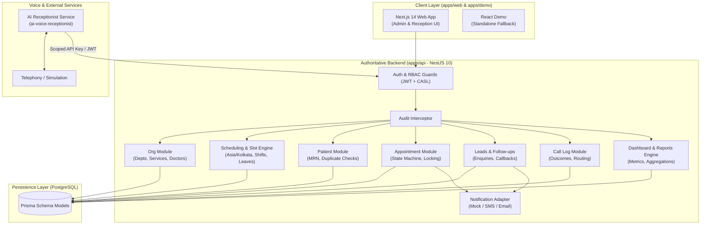

# Technical Implementation Plan: HMS Unified Module Integration

**Reference Document:** [COMPLETE_INTEGRATION.md](file:///c:/Users/Abhaykumar/OneDrive/Desktop/HMS/docs/COMPLETE_INTEGRATION.md)  
**Target Branch:** `integration/full-software-modules-2026-10-27`  
**Architecture:** Turborepo Modular Monolith (`apps/api` [NestJS + Prisma], `apps/web` [Next.js 14], `packages/shared-types`, `ai-voice-receptionist` [Python FastAPI adapter])  
**Target Completion Standard:** Functional end-to-end multi-module system backed by PostgreSQL, authoritative business rules, RBAC enforcement, and automated integration tests.

---

## 1. Executive Context & Current Baseline Audit

An audit of the repository reveals the exact delta between current source trees and the target PRD:

```
┌────────────────────────────────────────────────────────────────────────────┐
│                             CURRENT STATE                                  │
├────────────────────────┬───────────────────────────────────────────────────┤
│ apps/api (NestJS)      │ Basic Auth & Audit, stub Patient & fixed mock     │
│                        │ Appointment slots (UTC). Lacks Doctor, Department,│
│                        │ Schedule, Lead, Call, Task models & slot engine.  │
├────────────────────────┼───────────────────────────────────────────────────┤
│ apps/demo (React/Vite) │ Standalone single-tab demo with pure domain rules │
│                        │ (domain.js) in localStorage. Disconnected from DB.│
├────────────────────────┼───────────────────────────────────────────────────┤
│ apps/web (Next.js 14)  │ App router layout + mock dashboard pages. Not yet │
│                        │ connected to backend REST endpoints.              │
├────────────────────────┼───────────────────────────────────────────────────┤
│ ai-voice-receptionist  │ Standalone FastAPI prototype with mock/live mode. │
│ (Python)               │ Configured for external n8n HMS instead of API.   │
└────────────────────────┴───────────────────────────────────────────────────┘
```

**Implementation Mission:** Port the tested business logic from `apps/demo/src/state/domain.js` and feature branches into the authoritative NestJS backend (`apps/api`), update the Prisma schema, wire `apps/web` to persistent API endpoints, connect the AI voice adapter via scoped APIs, and validate all 4 core user journeys against automated tests.

---

## 2. Prerequisite Architectural Decisions (Resolving PRD Section 15)

| # | PRD Question | Technical Decision & Concrete Standard |
|---|---|---|
| **1** | Authoritative integration branch | `integration/full-software-modules-2026-10-27` is the authoritative baseline branch. |
| **2** | Target Database & Migrations | PostgreSQL with Prisma ORM (`apps/api/prisma/schema.prisma`). All schema changes delivered through tracked Prisma migrations (`prisma migrate dev`). |
| **3** | Authentication & Role Model | NestJS Passport JWT with HTTP-only cookies and Argon2 password hashing. CASL-based `@CheckPolicies()` decorator for endpoint RBAC. Demo local login in `apps/demo` remains separate. |
| **4** | Scheduling & Timezone | Standardized to **`Asia/Kolkata` (IST)**. Slot granularity default is 30 minutes. Timestamps stored as UTC in Postgres and serialized with ISO 8601 offset. |
| **5** | Concurrency Strategy | Database transactions with row-level locks (`SELECT ... FOR UPDATE` via raw SQL or optimistic locking with unique composite constraints on `[doctorId, scheduledStart, scheduledEnd]` where status $\neq$ `CANCELLED`). |
| **6** | AI Voice Receptionist Mode | **Dual-mode adapter**: Runs in **Simulation / Local Mock** mode by default (requiring no external telephony or paid API keys). Can switch to Twilio/OpenAI via environment variables. |
| **7** | Notification System | **Mock In-Memory / Structured Log Provider** by default (`MockNotificationProvider`) with templating for SMS/Email. Accurately tracks status (`QUEUED`, `DELIVERED`, `FAILED`). |
| **8** | Test Framework | Jest + Supertest with an isolated test PostgreSQL database / Docker test instance for backend integration tests; Vitest for shared-types. |

---

## 3. System Architecture & Information Flow



---

## 4. Phase-by-Phase Implementation Roadmap

```mermaid
gantt
    title HMS Complete Integration Plan
    dateFormat  YYYY-MM-DD
    section Phase 0: Baseline & Schema
    Prisma Schema & Migrations           :p0_1, 2026-10-28, 2d
    Shared Types Synchronization         :p0_2, after p0_1, 1d
    section Phase 1: Security & Foundation
    Auth Hardening & Refresh Tokens      :p1_1, after p0_2, 2d
    RBAC & CASL Permission Matrix        :p1_2, after p1_1, 1d
    Audit Interceptor Refactoring        :p1_3, after p1_2, 1d
    section Phase 2: Organization & Slots
    Departments, Services, Doctors CRUD  :p2_1, after p1_3, 2d
    Doctor Schedules, Leaves & Shifts    :p2_2, after p2_1, 2d
    Authoritative Slot Generator Engine  :p2_3, after p2_2, 2d
    section Phase 3: Core Administration
    Patient Duplicate Logic & Directory  :p3_1, after p2_3, 2d
    Appointment State Machine & Locking  :p3_2, after p3_1, 2d
    Next.js Appointment & Patient Views  :p3_3, after p3_2, 2d
    section Phase 4: CRM & Reporting
    Leads & Follow-up Task Workflows     :p4_1, after p3_3, 2d
    Call Logs & AI Call Outcome Ingestion:p4_2, after p4_1, 1d
    Operational Reports & KPIs           :p4_3, after p4_2, 2d
    section Phase 5: AI & Notifications
    AI Voice Receptionist HMS Adapter    :p5_1, after p4_3, 2d
    Notification Dispatcher & Templates  :p5_2, after p5_1, 1d
    section Phase 6: E2E Testing & Demo
    User Journeys A-D Integration Tests  :p6_1, after p5_2, 3d
    Seed Data, Demo Script & Runbook     :p6_2, after p6_1, 1d
```

---

### Phase 0: Canonical Data Model & Schema Harmonization
**Goal:** Align [`apps/api/prisma/schema.prisma`](file:///c:/Users/Abhaykumar/OneDrive/Desktop/HMS/apps/api/prisma/schema.prisma) with the PRD data model and generate type definitions in `packages/shared-types`.

#### Tasks:
1. **Extend Prisma Schema with Canonical Entities:**
   - Add `Department` (`id`, `name`, `code`, `isActive`, `createdAt`).
   - Add `Service` (`id`, `departmentId`, `name`, `durationMinutes`, `price`, `isActive`).
   - Add `Doctor` (`id`, `userId`, `departmentId`, `specialization`, `consultationFee`, `isActive`).
   - Add `DoctorSchedule` (`id`, `doctorId`, `dayOfWeek`, `startTime`, `endTime`, `slotDurationMinutes`, `breakStart`, `breakEnd`, `maxCapacity`).
   - Add `DoctorLeave` (`id`, `doctorId`, `startDate`, `endDate`, `reason`).
   - Add `Lead` (`id`, `patientId?`, `name`, `phone`, `email?`, `source`, `status` [*NEW, CONTACTED, CONVERTED, CLOSED*], `assignedToUserId?`, `notes`).
   - Add `FollowUpTask` (`id`, `leadId?`, `patientId?`, `assignedToUserId`, `dueDate`, `priority`, `status` [*PENDING, COMPLETED, OVERDUE*], `notes`).
   - Add `CallLog` (`id`, `callerPhone`, `callerName?`, `patientId?`, `leadId?`, `appointmentId?`, `direction`, `durationSeconds`, `intent`, `outcome` [*COMPLETED, FAILED, ESCALATED, ABANDONED*], `summary`, `recordingConsent`).
   - Add `Notification` (`id`, `appointmentId?`, `leadId?`, `channel` [*SMS, EMAIL, WHATSAPP*], `recipient`, `templateId`, `status` [*PENDING, SENT, FAILED*], `providerResponse?`, `retryCount`).
2. **Upgrade Existing Models:**
   - `Patient`: add `alternatePhone`, `emergencyContact`, `normalizedPhone`, indexes on `phone` and `email`.
   - `Appointment`: replace string status with enum (`REQUESTED`, `CONFIRMED`, `CHECKED_IN`, `COMPLETED`, `CANCELLED`, `NO_SHOW`); add `serviceId`, `requestId` (for idempotency), `cancellationReason`.
   - Add composite unique index: `@@unique([doctorId, scheduledStart, scheduledEnd, status])` or partial index to prevent double bookings.
3. **Generate Migrations & Update Shared Types:**
   - Execute `npx prisma migrate dev --name init_canonical_hms_schema`.
   - Export TypeScript interfaces from `packages/shared-types` matching all DTOs and Prisma models.

**Deliverables:**
- Checked-in Prisma migration in `apps/api/prisma/migrations/`.
- Updated `@hospital/shared-types` with full entity and DTO types.

---

### Phase 1: Shared Foundation & Hardened Auth/Audit
**Goal:** Guarantee rock-solid session security, RBAC enforcement, and tamper-resistant audit logs.

#### Tasks:
1. **Fix Authentication Flaws (Resolving `AUTHENTICATION.md` findings):**
   - Implement refresh token rotation endpoint (`POST /api/auth/refresh`) using hashed DB tokens.
   - Restrict cookie scopes: `httpOnly: true`, `secure: process.env.NODE_ENV === 'production'`, `sameSite: 'lax'`.
   - Enforce active user checks (`isActive === true` and `deletedAt === null`) in `JwtStrategy`.
2. **Refine Permissions & Roles (FR-AUTH-01..04):**
   - Seed canonical roles: `SUPER_ADMIN`, `ADMIN`, `RECEPTIONIST`, `DOCTOR`, `AI_SERVICE`.
   - Map granular permissions (`availability:read`, `booking:create`, `booking:cancel`, `patient:read`, `patient:write`, `reports:read`, `audit:read`).
   - Create a service identity token for `AI_SERVICE` with restricted permissions (read availability, create booking requests, log calls).
3. **Audit Logging Interceptor & Redaction (FR-AUTH-05..07):**
   - Convert `AuditService` into a global NestJS Interceptor with transactional write guarantee.
   - Redact all sensitive fields (passwords, tokens, credentials, full card numbers) before DB write.
   - Enforce immutable audit log retrieval (`GET /api/audit-logs`) with role check (`ADMIN` / `AUDIT_USER` only).

**Deliverables:**
- Passing tests in `apps/api/src/auth` and `apps/api/src/audit`.
- `AI_SERVICE` token generator script for inter-service communication.

---

### Phase 2: Organization, Schedule & Slot Engine
**Goal:** Build the authoritative availability calculation engine (FR-ORG-01..07) eliminating mock slots and external dependencies.

#### Tasks:
1. **Department, Service & Doctor Modules:**
   - Implement NestJS modules: `DepartmentsModule`, `ServicesModule`, `DoctorsModule`.
   - CRUD controllers with DTO validation (`class-validator`).
2. **Schedule & Slot Engine (`ScheduleService`):**
   - Port time interval arithmetic from `apps/demo/src/state/domain.js` into a robust TypeScript service.
   - Inputs: `doctorId`, `serviceId`, `date` (YYYY-MM-DD).
   - Algorithm:
     1. Validate date and ensure it is not past or outside configured booking horizon.
     2. Retrieve doctor working hours for day-of-week (`DoctorSchedule`).
     3. Check for approved leaves in `DoctorLeave`; return empty if on leave.
     4. Calculate discrete slots matching `service.durationMinutes` in `Asia/Kolkata` timezone.
     5. Exclude configured break windows (`breakStart` to `breakEnd`).
     6. Retrieve existing non-cancelled appointments for that doctor and date.
     7. Subtract booked intervals.
     8. Output validated available slots with ISO 8601 timestamps and hospital timezone.
3. **Endpoint Implementation:**
   - `GET /api/doctors/:id/availability?date=YYYY-MM-DD&serviceId=XYZ`
   - Response complies exactly with the PRD Section 8 contract.

**Deliverables:**
- Unit test suite (`schedule.service.spec.ts`) validating working hours, split shifts, breaks, leaves, and booked slot subtractions.

---

### Phase 3: Core Administration & Appointments (Journeys A & D)
**Goal:** Deliver end-to-end patient management and atomic, conflict-free appointment booking (FR-PAT-01..06, FR-APT-01..09).

#### Tasks:
1. **Patient Management & Duplicate Detection:**
   - Phone normalization (handling country code +91 and standardizing to 10 digits).
   - Duplicate detection query: Check for matching phone or email. Return `409 Conflict` or flagged matches rather than silently overriding.
   - Auto-generation of stable, immutable `MRN` (e.g., `MRN-YYYYMMDD-XXXX`).
2. **Atomic Appointment Booking Engine:**
   - Implement `AppointmentsService.createBooking()` inside a Prisma interactive transaction:
     ```typescript
     await this.prisma.$transaction(async (tx) => {
       // 1. Check idempotency via requestId if provided
       // 2. Validate doctor, service, and patient existence
       // 3. Acquire slot check lock
       const conflict = await tx.appointment.findFirst({
         where: {
           doctorId: dto.doctorId,
           status: { notIn: ['CANCELLED', 'NO_SHOW'] },
           scheduledStart: { lt: requestedEnd },
           scheduledEnd: { gt: requestedStart },
         },
       });
       if (conflict) throw new ConflictException('Selected slot is no longer available');
       // 4. Create appointment
       // 5. Emit AUDIT and NOTIFICATION events
     });
     ```
3. **Appointment Lifecycle State Machine (FR-APT-09):**
   - Valid transitions:
     - `REQUESTED` $\rightarrow$ `CONFIRMED` or `CANCELLED`
     - `CONFIRMED` $\rightarrow$ `CHECKED_IN`, `CANCELLED`, or `NO_SHOW`
     - `CHECKED_IN` $\rightarrow$ `COMPLETED` or `NO_SHOW`
   - Dedicated endpoints:
     - `PATCH /api/appointments/:id/reschedule`
     - `POST /api/appointments/:id/cancel` (with mandatory reason)
     - `PATCH /api/appointments/:id/status`

**Deliverables:**
- Concurrency test asserting that 10 parallel booking requests for the exact same slot result in exactly 1 success and 9 conflict rejections.

---

### Phase 4: Leads, Reception Calls & Operations (Journey C)
**Goal:** Connect enquiry capture, callback tasks, reception call records, and dashboard reporting (FR-LEAD-01..07, FR-CALL-01..06, FR-DASH-01..06).

#### Tasks:
1. **Leads & Follow-up Tasks (`LeadsModule`):**
   - Endpoints: `POST /api/leads`, `GET /api/leads`, `POST /api/follow-up-tasks`, `PATCH /api/follow-up-tasks/:id`.
   - Support conversion of a lead into an appointment or patient record without losing enquiry history.
   - Task overdue detection query based on hospital date.
2. **Reception Call Logs (`CallsModule`):**
   - Endpoints: `POST /api/call-logs`, `GET /api/call-logs`.
   - Store call duration, direction, outcome (`COMPLETED`, `ESCALATED`, `FAILED`, `ABANDONED`), structured summary, and link to created `Lead` or `Appointment`.
3. **Authoritative Operational Reporting Engine (`ReportsModule`):**
   - Replace demo mock aggregations with live Prisma queries:
     - Daily appointments by status.
     - Doctor utilization rate = $\frac{\text{Total booked minutes}}{\text{Total scheduled working minutes}}$.
     - Enquiries vs conversions count.
     - Reception call outcome breakdowns.
   - Endpoint: `GET /api/reports/summary?from=YYYY-MM-DD&to=YYYY-MM-DD`.

**Deliverables:**
- Live operational dashboard endpoint backed by indexed PostgreSQL aggregations.

---

### Phase 5: AI Receptionist Adapter & Notification Gateway (Journey B)
**Goal:** Deliver a provider-neutral voice integration and mock notification dispatcher (FR-AI-01..14, FR-NOT-01..07).

#### Tasks:
1. **Connect `ai-voice-receptionist` to Authoritative HMS API:**
   - In [`ai-voice-receptionist/app/services/hms_api.py`](file:///c:/Users/Abhaykumar/OneDrive/Desktop/HMS/ai-voice-receptionist/app/services/hms_api.py), replace n8n endpoints with official NestJS endpoints:
     - `GET /api/doctors/:id/availability`
     - `POST /api/appointments` (submitting as `REQUESTED` with explicit caller confirmation)
     - `POST /api/call-logs`
     - `POST /api/leads` (when caller requests callback or enquiry)
   - Authenticate with `AI_SERVICE` JWT or internal API key header (`x-internal-api-key`).
2. **Medical & Safety Guardrails (FR-AI-11..12):**
   - Enforce system prompts in AI receptionist: Immediate refusal and escalation script on emergency keywords (chest pain, severe bleeding, difficulty breathing, suicide, stroke symptoms).
   - Clearly identify as "Automated AI Receptionist" in call greeting.
3. **Notification Gateway (`NotificationsModule`):**
   - Implemented in `apps/api/src/notifications`.
   - `MockNotificationProvider`: Generates structured logs and records to the `Notification` table with status `SENT` and payload details.
   - Pluggable interface (`NotificationProvider`) for future SMS/Email integration.

**Deliverables:**
- Working end-to-end integration test of simulated voice call booking an appointment via the NestJS API.

---

### Phase 6: Web Frontend Integration & UI Unification
**Goal:** Wire [`apps/web`](file:///c:/Users/Abhaykumar/OneDrive/Desktop/HMS/apps/web) to the real NestJS API, replacing static prototypes with a unified responsive interface.

#### Tasks:
1. **API Client & Authentication State:**
   - Configure centralized Axios / Fetch client in `apps/web/lib/api-client.ts` with `credentials: 'include'` and baseURL `/api`.
   - Connect login and session restoration to `apps/api/src/auth`.
2. **Screen Integration:**
   - **Appointments (`/appointments`):** Calendar/list view, booking modal consuming real availability slots, reschedule modal, cancel action.
   - **Patients (`/patients`):** Search directory with debounced query, registration modal with duplicate warning.
   - **Doctors & Schedules (`/doctors`):** Doctor profiles, department filters, weekly schedule configuration view.
   - **Enquiries & Calls (`/calls`, `/leads`):** Reception call log table, lead pipeline, follow-up task checklist.
   - **Dashboard (`/dashboard`):** Operational KPI cards, appointment status charts, real-time activity stream from audit logs.
3. **UI Feedback & UX Polish:**
   - Distinct badges for `REQUESTED` (Pending AI request) vs `CONFIRMED`.
   - Loading skeletons, empty states, and standard error toasts.

**Deliverables:**
- Unified Next.js frontend running cleanly against `apps/api`.

---

### Phase 7: Validation, Test Automation & Demo Runbook
**Goal:** Execute comprehensive integration tests and provide a reproducible demonstration runbook.

#### Tasks:
1. **Automated Integration Test Matrix:**
   - **Journey A Test:** Receptionist creates patient $\rightarrow$ searches doctor slots $\rightarrow$ books appointment $\rightarrow$ verifies audit entry and dashboard count increment.
   - **Journey B Test:** AI agent requests availability $\rightarrow$ submits booking with request key $\rightarrow$ verifies `REQUESTED` status and call log.
   - **Journey C Test:** Caller enquiry $\rightarrow$ creates lead $\rightarrow$ generates callback task $\rightarrow$ marks completed.
   - **Journey D Test:** Booking attempt on unavailable slot returns `409 Conflict` $\rightarrow$ alternate slot suggested.
   - **Security Test:** Unauthorized user receives `401/403` on `/api/audit-logs` and `/api/patients`.
2. **Seed Data Script (`apps/api/prisma/seed.ts`):**
   - Generates realistic fictional dataset:
     - 4 Departments (Cardiology, Orthopedics, Pediatrics, General Medicine).
     - 8 Doctors with realistic schedules and working shifts.
     - 20 Synthetic Patients with valid MRNs.
     - 30 Appointments across various statuses.
     - 10 Leads and 10 Follow-up Tasks.
     - Admin, Receptionist, Doctor, and AI Service user accounts.
3. **Reproducible Demo Script (`scripts/demo-start.bat` / PowerShell):**
   - Starts PostgreSQL, runs migrations, seeds data, starts NestJS API on `:4000`, starts Next.js Web on `:3000`.

---

## 5. End-to-End User Journeys Verification Matrix

| Journey | Description | Key Modules Involved | Verification Criterion |
|---|---|---|---|
| **Journey A** | Receptionist books an appointment | `Auth`, `Patients`, `Doctors`, `Appointments`, `Audit` | Appointment committed to DB; slot no longer offered; audit record generated; visible in reception dashboard. |
| **Journey B** | AI requests or books an appointment | `AI Voice Adapter`, `Schedule Engine`, `Appointments`, `CallLog` | Slot retrieved from live API; appointment created with source `AI_VOICE`; structured call outcome logged; no false confirmations. |
| **Journey C** | Enquiry and staff follow-up | `Leads`, `Tasks`, `CallLog`, `Audit` | Enquiry creates lead and linked follow-up task with due date; visible on reception task board; status updates auditable. |
| **Journey D** | Doctor unavailable handling | `Schedule Engine`, `Appointments`, `Leads` | Engine correctly rejects booked/leave slot; offers alternate valid slots or creates callback lead; no double booking. |

---

## 6. Risk Management & Mitigations

| Identified Risk | Impact | Concrete Mitigation |
|---|---|---|
| **Concurrent double-booking** | High | Transactional slot reservation in PostgreSQL with isolation checks and composite unique constraints on active appointment slots. |
| **Data duplication during patient entry** | Medium | Automated phone normalization + fuzzy search duplicate warning prompt before final record creation. |
| **AI hallucinating slot times** | Critical | Strict system prompt instruction + server-side validation rejecting any slot not returned by `getAvailability`. |
| **External notification/voice failure** | Medium | Isolated behind `NotificationProvider` and `VoiceAdapter` interfaces with bounded timeouts, fallback states, and structured error logging. |
| **Cross-environment timezone drift** | High | All calculations, shifts, and slot boundaries strictly anchored to `Asia/Kolkata` using `date-fns-tz` or standard Intl formatting. |

---

## 7. Definition of Done (DoD) & Acceptance Sign-off

The integration will be marked complete only when all the following criteria pass:

- [ ] `npm run build` succeeds across root workspace (`apps/api`, `apps/web`, `packages/shared-types`).
- [ ] Database migrations run cleanly on an empty database via `npx prisma migrate dev`.
- [ ] Seed script (`npx prisma db seed`) populates all fictional hospital records reliably.
- [ ] Automated integration tests for Journeys A, B, C, and D pass with 100% success.
- [ ] Role-based access control blocks unauthorized role escalation and protects audit records.
- [ ] Concurrent booking simulation proves zero overlapping bookings for single-doctor exclusive slots.
- [ ] Next.js administrative frontend renders live PostgreSQL data without mock fallbacks.
- [ ] AI voice receptionist simulation successfully completes booking flow against the NestJS backend.