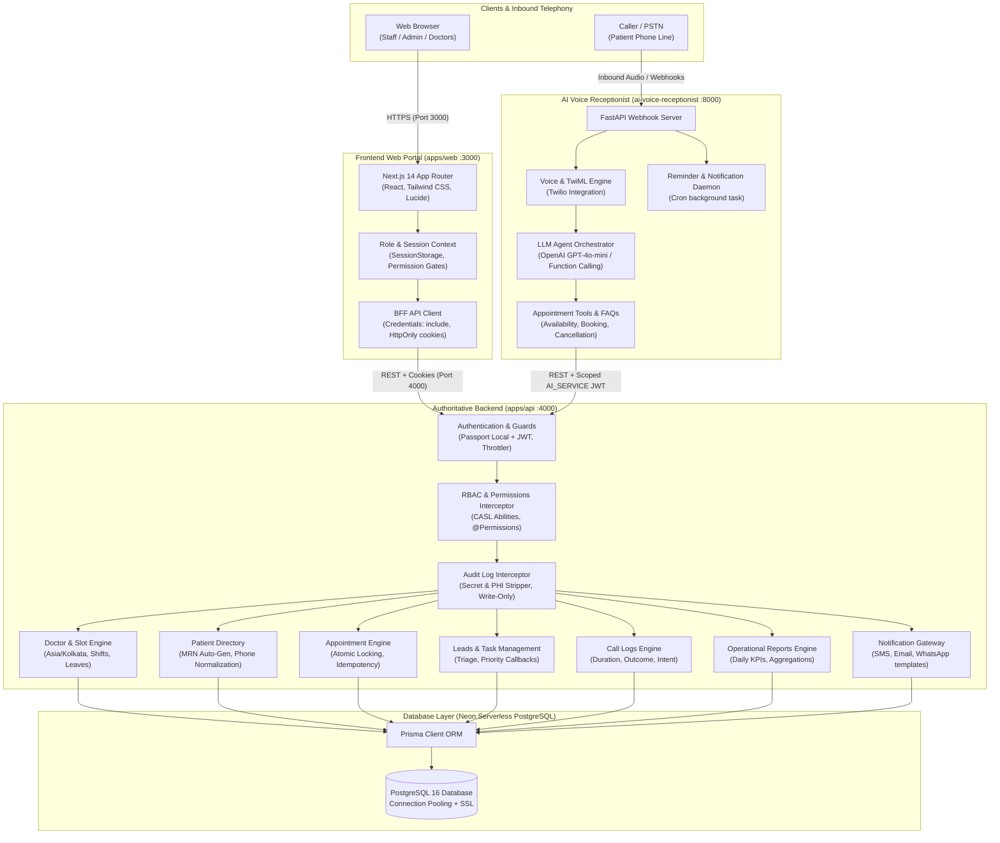
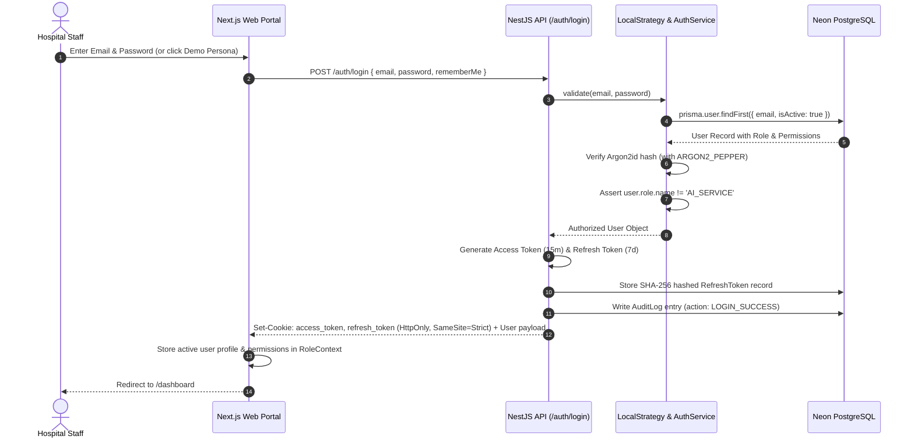
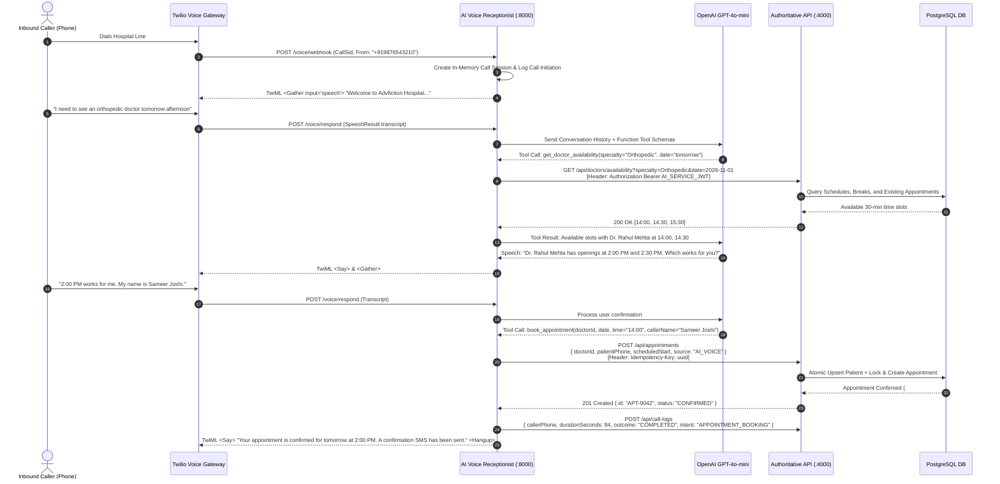
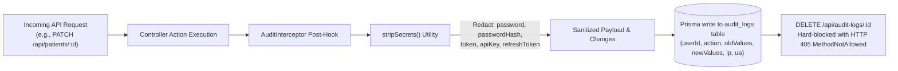
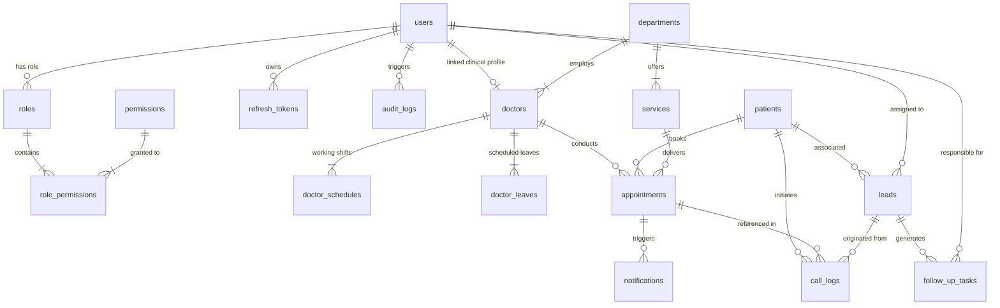

# HealthPulse Hospital Management System (HMS) — System Functional Overview

---

## 1. Executive Architecture Summary

HealthPulse HMS is an enterprise-grade, integrated clinical operations and telephony automation platform. The architecture separates concerns across three decoupled tiers while maintaining strict contract consistency via a shared TypeScript definitions package:

1. **Frontend Presentation Layer (`apps/web`)**: Next.js 14 (App Router) administrative & clinical portal operating on port `3000`.
2. **Authoritative Backend API (`apps/api`)**: NestJS 10 REST API backed by Prisma ORM and Neon PostgreSQL operating on port `4000`.
3. **AI Voice Receptionist Service (`ai-voice-receptionist`)**: Python 3.10+ FastAPI microservice integrating Twilio Voice & OpenAI GPT-4o-mini operating on port `8000`.
4. **Shared Type System (`packages/shared-types`)**: Canonical TypeScript domain models, permission actions, and role mappings shared across frontend and backend.



---

## 2. Complete End-to-End Data Flows

### A. Authentication & Session Life Cycle

The system uses email and password credentials. Roles are resolved authoritative server-side from the database rather than declared by the client.



---

### B. Inbound AI Voice Receptionist & Telephony Flow

When a patient calls the hospital's phone line, the AI Receptionist handles triage, queries doctor availability, books appointments, and captures call logs without human intervention.



---

### C. Emergency Handoff & CRM Escalation Flow

If the caller describes severe emergency symptoms (e.g., chest pain, breathing difficulty) or explicitly asks for a human agent:

1. **Immediate Detection**: The LLM prompt triggers the `handoff_to_human` function tool.
2. **Telemetry Log**: `FastAPI` creates a high-priority Lead and Follow-up Task in `apps/api`:
   - `POST /api/leads` (Source: `AI_RECEPTIONIST`, Status: `NEW`, Notes: "Caller requested human transfer / emergency triage").
   - `POST /api/tasks` (Priority: `URGENT`, Due Date: immediate).
3. **Telephony Transfer**: Twilio issues a `<Dial>` verb forwarding the audio stream to the live human receptionist desk.
4. **Dashboard Alert**: The Next.js dashboard `/leads-calls` updates live, displaying the urgent callback card to the on-duty receptionist.

---

### D. Immutable PHI & Secret-Redacting Audit Flow

Every state-mutating operation (`POST`, `PUT`, `PATCH`, `DELETE`) is captured by the NestJS `AuditInterceptor`:



---

## 3. How the AI Voice Receptionist Module Works with the Project

The AI Voice Receptionist (`ai-voice-receptionist`) is architected as an autonomous agent that interfaces with the central hospital system via REST APIs using machine-scoped credentials.

### Key Architectural Pillars:

| Component | Implementation Details |
|---|---|
| **Autonomous Telephony Engine** | Built with **FastAPI**, **Twilio Voice SDK**, and **OpenAI Structured Outputs**. Operates asynchronously with connection pooling and non-blocking I/O. |
| **Machine Security Identity** | Authenticates against `apps/api` using a dedicated JWT signed with `AI_SERVICE_JWT_SECRET` having `role: 'AI_SERVICE'` and scoped permissions (`availability:read`, `booking:create`, `call:manage`). |
| **Strict Anti-Impersonation Guard** | The NestJS `LocalStrategy` and `AuthService` explicitly reject `AI_SERVICE` from logging in through the human staff portal, ensuring machine credentials cannot access staff views. |
| **Concurrency & Idempotency** | Every booking submission sends an `Idempotency-Key` HTTP header. If network glitches cause Twilio to retry webhooks, the NestJS backend prevents duplicate bookings. |
| **Dual Mode Operation** | Configured via `.env` (`HMS_MODE=live` or `mock`). In development or testing without live telephony/DB, it seamlessly uses SQLite (`medislot.db`) and mock HMS adapters. |
| **Local Slot Verification** | Real-time slot calculation checks the doctor's shift schedules, lunch break intervals (`13:00 - 14:00`), approved leaves, and atomic overlap collisions before offering times to callers. |

---

## 4. Role-Based Access Control (RBAC) & User Permissions

The platform implements strict Least-Privilege Role-Based Access Control enforced at the controller level via NestJS `@UseGuards(JwtAuthGuard, RolesGuard, PermissionsGuard)`.

### A. Granular Permission Actions Reference

There are **19 canonical permission tokens** in the system:

| Domain | Permission Action | Description |
|---|---|---|
| **Scheduling** | `availability:read` | Inspect doctor working hours, shift windows, and open slots |
| **Booking** | `booking:create` | Reserve and create a confirmed clinical appointment |
| **Patients** | `patient:read` | View patient demographics, contact info, and medical history |
| | `patient:create` | Register a new patient and issue unique MRN |
| | `patient:update` | Edit existing patient record, address, or phone |
| | `patient:delete` | Soft-delete patient record (restricted to Super Admin) |
| **Appointments**| `appointment:read` | View hospital appointment schedules and status |
| | `appointment:create` | Staff-assisted clinical appointment booking |
| | `appointment:update` | Update appointment status (CHECKED_IN, COMPLETED, NO_SHOW) |
| | `appointment:cancel` | Cancel appointment with mandatory cancellation reason |
| **Audit Logs** | `audit:read` | View compliance, audit trail, and security event logs |
| **Administration**| `user:manage` | Create, invite, deactivate staff accounts and assign roles |
| | `report:read` | Access operational reports, aggregations, and revenue KPIs |
| | `department:manage`| Configure hospital clinical departments and services |
| | `doctor:manage` | Manage doctor rosters, shift timings, and leaves |
| **CRM & Telephony**| `lead:manage` | View, assign, and update patient leads and callbacks |
| | `task:manage` | Track and complete follow-up enquiry tasks |
| | `call:manage` | Access inbound/outbound telephony logs and AI call summaries |
| **Alerts** | `notification:send` | Dispatch manual or automated SMS/Email/WhatsApp alerts |

---

### B. Role-Permission Matrix

```
┌────────────────────┬─────────────┬───────┬──────────────┬────────┬───────┬────────────┐
│ Permission Action  │ SUPER_ADMIN │ ADMIN │ RECEPTIONIST │ DOCTOR │ NURSE │ AI_SERVICE │
├────────────────────┼─────────────┼───────┼──────────────┼────────┼───────┼────────────┤
│ availability:read  │      ✅     │   ❌  │      ✅      │   ✅   │   ❌  │     ✅     │
│ booking:create     │      ✅     │   ❌  │      ✅      │   ❌   │   ❌  │     ✅     │
│ patient:read       │      ✅     │   ✅  │      ✅      │   ✅   │   ✅  │     ❌     │
│ patient:create     │      ✅     │   ✅  │      ✅      │   ❌   │   ❌  │     ❌     │
│ patient:update     │      ✅     │   ✅  │      ✅      │   ❌   │   ❌  │     ❌     │
│ patient:delete     │      ✅     │   ❌  │      ❌      │   ❌   │   ❌  │     ❌     │
│ appointment:read   │      ✅     │   ✅  │      ✅      │   ✅   │   ✅  │     ❌     │
│ appointment:create │      ✅     │   ✅  │      ✅      │   ❌   │   ❌  │     ❌     │
│ appointment:update │      ✅     │   ✅  │      ✅      │   ✅   │   ✅  │     ❌     │
│ appointment:cancel │      ✅     │   ✅  │      ✅      │   ❌   │   ❌  │     ❌     │
│ audit:read         │      ✅     │   ❌  │      ❌      │   ❌   │   ❌  │     ❌     │
│ user:manage        │      ✅     │   ✅  │      ❌      │   ❌   │   ❌  │     ❌     │
│ report:read        │      ✅     │   ✅  │      ❌      │   ❌   │   ❌  │     ❌     │
│ department:manage  │      ✅     │   ✅  │      ❌      │   ❌   │   ❌  │     ❌     │
│ doctor:manage      │      ✅     │   ✅  │      ❌      │   ❌   │   ❌  │     ❌     │
│ lead:manage        │      ✅     │   ✅  │      ✅      │   ❌   │   ❌  │     ❌     │
│ task:manage        │      ✅     │   ✅  │      ✅      │   ❌   │   ❌  │     ❌     │
│ call:manage        │      ✅     │   ✅  │      ✅      │   ❌   │   ❌  │     ✅     │
│ notification:send  │      ✅     │   ✅  │      ❌      │   ❌   │   ❌  │     ❌     │
└────────────────────┴─────────────┴───────┴──────────────┴────────┴───────┴────────────┘
```

---

### C. User Persona Descriptions & Operational Scope

#### 1. Super Admin (`superadmin@hospital.com`)
* **Scope**: Hospital CEO, Chief Medical Officer, or Chief Compliance Officer.
* **Access**: Complete, unrestricted system access across all clinical and administrative domains.
* **Exclusive Privileges**:
  - Exclusive access to `/audit-logs` (immutable event log inspection).
  - Ability to execute soft-deletions on clinical records (`patient:delete`).
  - System-wide security configurations and role assignments.

#### 2. Operations Admin (`admin@hospital.com`)
* **Scope**: Hospital Practice Manager or Operations Lead.
* **Access**: Department configurations (`/settings`), doctor rosters and leaves (`/doctors`), staff account management, and aggregate operational performance reports (`/reports`).
* **Restrictions**: Cannot inspect immutable audit logs or permanently purge patient entities.

#### 3. Lead Receptionist (`reception@hospital.com`)
* **Scope**: Front desk coordinators, patient check-in staff, call centre agents.
* **Access**: Full operational control over patient intake (`/patients`), appointment scheduling & calendar dispatch (`/appointments`), inbound/outbound telephony and CRM leads (`/leads-calls`).
* **Restrictions**: Cannot alter hospital pricing, doctor profiles, user accounts, or view financial reports.

#### 4. Attending Doctor (`doctor@hospital.com`)
* **Scope**: Specialists, Physicians, Surgeons (e.g., Dr. Sarah Jenkins, Dr. Arthur Vance).
* **Access**: Clinical inspection of assigned appointments, doctor duty rosters, and patient medical demographics. Can update consultation states (`CHECKED_IN`, `COMPLETED`).
* **Restrictions**: Cannot register new staff, configure departments, view unassigned lead CRM tickets, or delete appointments.

#### 5. Care Nurse (`nurse@hospital.com`)
* **Scope**: Triage nurses, floor ward assistants.
* **Access**: Patient lookup (`patient:read`) and appointment status updates (`CHECKED_IN`) to prepare patients for clinical examination.
* **Restrictions**: Read-only clinical demographics; no financial, roster, or administrative access.

#### 6. AI Receptionist (`AI_SERVICE` machine identity)
* **Scope**: Automated background agent handling inbound voice calls and appointment self-service.
* **Access**: Strictly scoped machine token limited to:
  - `availability:read`: Querying open slots.
  - `booking:create`: Creating voice-booked appointments.
  - `call:manage`: Logging call recordings, duration, and AI transcripts.
* **Restrictions**: Zero access to patient directories, audit logs, doctor management, staff accounts, or web dashboard authentication.

---

## 5. Database Schema & Entity Relationships



### Table Definitions & Primary Storage Roles

1. **`users`**: Staff accounts, argon2id password hashes, active status flag, and role references.
2. **`roles` & `permissions`**: Many-to-many RBAC catalog mapping fine-grained actions to human and machine roles.
3. **`departments`**: Clinical branches (Cardiology, Orthopedics, Pediatrics, General Medicine).
4. **`doctors`**: Physician profiles, department links, consultation fees, and user account linkage.
5. **`doctor_schedules`**: Day-of-week shift definitions (`09:00 - 17:00`), slot duration (`30 mins`), and lunch breaks (`13:00 - 14:00`).
6. **`doctor_leaves`**: Date-range blocking intervals for doctor leaves or conferences.
7. **`patients`**: Master patient index, auto-generated MRN (`MRN-2026-XXXX`), phone numbers, and address details.
8. **`appointments`**: Central clinical booking records with atomic scheduledStart/End, status machine (`REQUESTED`, `CONFIRMED`, `CHECKED_IN`, `COMPLETED`, `CANCELLED`, `NO_SHOW`), and source (`RECEPTION`, `AI_VOICE`, `ONLINE`).
9. **`leads` & `follow_up_tasks`**: Patient inquiry tracking, status stages (`NEW`, `CONTACTED`, `CONVERTED`, `CLOSED`), and prioritized follow-up tickets.
10. **`call_logs`**: Telephony logs with caller phone, audio duration, AI intent categorization, and transcript summaries.
11. **`audit_logs`**: Write-only compliance trail recording caller IP, user agent, action code, and sanitized diff snapshots.

---

## 6. Port Allocations & Environment Configuration

| Service | Port | Primary Protocol | Auth Mechanism | Primary Dependencies |
|---|---|---|---|---|
| **`apps/web`** | `3000` | HTTP / Next.js SSR & CSR | HttpOnly Session Cookies | Talks to NestJS API (`:4000`) |
| **`apps/api`** | `4000` | HTTP / REST API | Bearer JWT & Cookies | Neon PostgreSQL (`:5432`) |
| **`ai-voice-receptionist`** | `8000` | HTTP / Webhooks / WebSocket | API Key / Bearer JWT | Talks to NestJS API (`:4000`) & Twilio / OpenAI |
| **`PostgreSQL`** | `5432` | TCP (SSL Required) | Database Password | Neon Cloud Hosted Serverless DB |

---

## 7. Verification & Health Monitoring

The system includes automated health and deployment verification scripts located in `/scripts`:

- **Verify Database Connectivity**:
  ```powershell
  npx tsx scripts/verify-neon.ts
  ```
  Validates direct and pooler connectivity to Neon PostgreSQL, counts active roles, users, patients, and audit records.

- **Run Authoritative Test Suites**:
  ```powershell
  cd apps/api && npm test
  ```
  Executes all 23 integration and RBAC test specs (`schedule-and-slots.spec.ts`, `verification-matrix.spec.ts`, `integrated-journeys.spec.ts`).

- **Verify AI Voice Receptionist Health**:
  ```powershell
  curl http://localhost:8000/health
  ```
  Returns status of telephony providers, LLM engine, and HMS connection mode.
